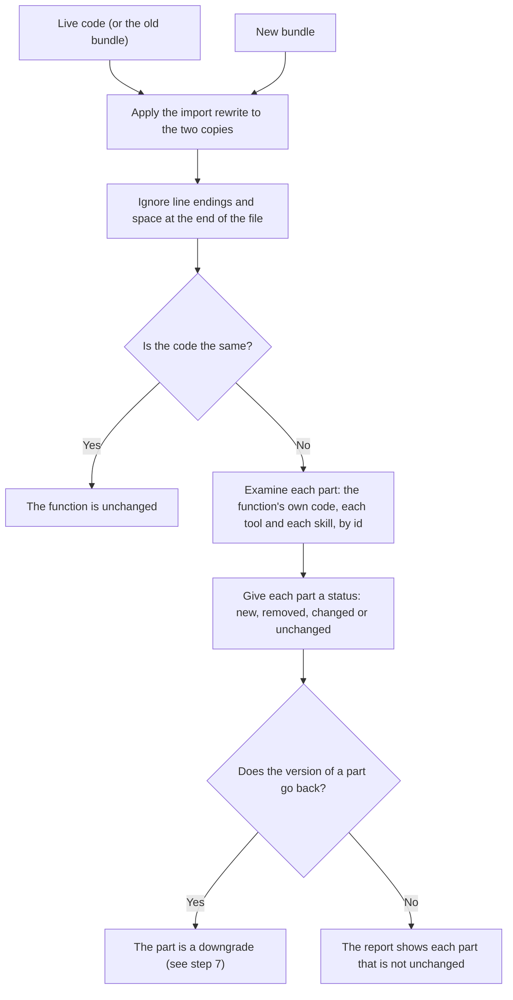

# owpp deploy

```
owpp deploy [--from FOLDER] [--only id,id] [--dry-run [--latest]] [--force]
            [--no-prune | --force-prune]
            [--managed-by marker] [--ca-cert PEM] [--client-cert PEM] [--client-key PEM]
            [--dir FOLDER]
```

`owpp deploy` puts the plugins on a running Open-WebUI. It creates, updates or leaves alone one function for each plugin. Then it prunes: it deletes each function that it manages and that no longer has a plugin. A **managed function** has this deploy's [ownership marker](#the-ownership-marker).

The command writes only **functions**, with their valves and their active and global states. The [runtime](../runtime.md) inside Open-WebUI installs the tools and skills, controlled by the function.

## Options

| Option | Meaning |
| --- | --- |
| `--from FOLDER` | Deploy the [build](#deploying-a-build) in this folder instead of the plugins folder. |
| `--only id,id` | Deploy only these ids, and prune nothing. Thus the deploy of one plugin cannot delete a different one. |
| `--dry-run` | Write nothing. [Report](#the-report-what-changes-in-versions) what changes, with versions. |
| `--latest` | With `--dry-run`: report against the latest commit that each git-sourced plugin follows, as [`owpp pull`](pull.md) moves it. `plugin.yaml` does not change. Refused without `--dry-run`. |
| `--force` | Deploy even where the instance runs a newer version than the repository. See [deploying an older version](#deploying-an-older-version). |
| `--no-prune` | Create and update, but delete nothing. The report lists each function that a full deploy deletes, as `not deleted (--no-prune)`. |
| `--force-prune` | Let one run delete two or more functions that are more than half of the managed functions. |
| `--managed-by marker` | The [ownership marker](#the-ownership-marker). Default [`$OWPP_MANAGED_BY`](../environment-variables.md#owpp_managed_by), else `open-webui-plugin-protocol`. |
| `--ca-cert PEM` | CA certificates to trust in addition to the system's, for a private CA or a self-signed Open-WebUI. Default [`$OPEN_WEBUI_CA_CERT`](../environment-variables.md#open_webui_ca_cert). |
| `--client-cert PEM` | A client certificate to present to a server or proxy that requires mutual TLS. Default [`$OPEN_WEBUI_CLIENT_CERT`](../environment-variables.md#open_webui_client_cert). |
| `--client-key PEM` | The certificate's private key, if it is not in the same PEM. Default [`$OPEN_WEBUI_CLIENT_KEY`](../environment-variables.md#open_webui_client_key). |
| `--dir FOLDER` | The plugins folder. Default [`$OWPP_PLUGINS_DIR`](../environment-variables.md#owpp_plugins_dir), else `./plugins`. |

Each certificate option, and its variable, takes a path to a PEM file or the PEM text.

## Deploy settings

The instance and the credentials come only from the environment, never from flags. Set [`OPEN_WEBUI_URL`](../environment-variables.md#open_webui_url) (required) and the [sign-in variables](#signing-in). In CI, the inputs of the [action](../tooling.md#github-action) set them. For every variable and its default, see [environment variables](../environment-variables.md).

## Signing in

The deploy needs an **admin** account of the instance. It uses the first of these that is set:

| Set | What it does | The instance needs |
| --- | --- | --- |
| [`OPEN_WEBUI_API_KEY`](../environment-variables.md#open_webui_api_key) | Uses the key as it is. | API keys on (Admin Panel > Settings > General > Enable API Keys), and a key from Settings > Account > API keys. |
| [`OPEN_WEBUI_USERNAME`](../environment-variables.md#open_webui_username) and [`OPEN_WEBUI_PASSWORD`](../environment-variables.md#open_webui_password) | Signs in to an Open-WebUI account, where the user name is the email (`POST /api/v1/auths/signin`). If that fails, signs in as an LDAP user (`POST /api/v1/auths/ldap`). | Password sign-in on. For an LDAP user, LDAP configured. |
| [`OPEN_WEBUI_OIDC_TOKEN`](../environment-variables.md#open_webui_oidc_token) | Exchanges the token for a session (`POST /api/v1/auths/oauth/<provider>/token/exchange`). [`OPEN_WEBUI_OAUTH_PROVIDER`](../environment-variables.md#open_webui_oauth_provider) names the provider, default `oidc`. | `ENABLE_OAUTH_TOKEN_EXCHANGE=true`, and that OAuth provider configured. |
| nothing | Signs in with no credentials, as the browser does. | Sign-in off (`WEBUI_AUTH=False`), or a proxy in front of it that adds the trusted email header (`WEBUI_AUTH_TRUSTED_EMAIL_HEADER`). |

The deploy uses a session only for that run. If the account is not an admin, the deploy stops before it writes anything. After a sign-in, the error says who signed in. If the sign-in fails, the error says what the deploy tried and why it failed.

## The ownership marker

Each function that the deploy writes gets `meta.managed_by = <marker>` and a note in its description. Set the marker with `--managed-by` or [`OWPP_MANAGED_BY`](../environment-variables.md#owpp_managed_by).

The deploy also records these in the function's meta:

- `meta.sources`: the commit of each git source, for the [report](#the-report-what-changes-in-versions).
- `meta.requires`: the plugin's [`requires:`](../plugin-format.md#requires) (`{}` for none). [`owpp import --instance`](import.md#what-owpp-put-into-it-taken-back-out) writes it back into `plugin.yaml`. The deploy does not update a function only to add it.

The marker is the **only** thing that controls pruning:

- The deploy deletes a function that has this marker and no plugin.
- It never deletes a function without this marker, such as one made by hand in the UI, or by a deploy with a different marker.

**Caution:** Do not give a plugin the id of a function on the instance unless you want to replace its code. The deploy updates that function and gives it the marker, even if it had none or a different one.

Use one marker for each source of truth. Two repositories that deploy to one instance need different markers. With the same marker, each deploy prunes the other's functions.

**Caution:** Do not change the marker of a deployment that already has functions. The deploy can then no longer prune the functions that have the old marker. See [adopting](../adopting.md#keep-your-existing-marker).

## What a deploy does

**Caution:** Before you add `--force-prune`, read the list of functions in the error. The deploy deletes each one.

A deploy does these steps in this order:

1. It waits for `GET /health`, because the instance can be in a restart.
2. It [signs in](#signing-in).
3. It fetches the git sources and bundles every plugin. With `--from`, it reads the build instead.
4. If a plugin [requires](../plugin-format.md#requires) `iframe_sandbox_allow_same_origin`, it reads the instance's admin config. If the setting is off, the report gets a **warning**. The deploy continues, and it does not change instance settings.
5. It lists the functions (`GET /api/v1/functions/list`). A bad API key fails here, before the deploy writes anything.
6. It stops if the run must delete two or more functions that are more than half of the managed functions. Thus renamed folders cannot delete them all. `--force-prune` removes this limit.
7. It stops if a version goes back, unless you give `--force` ([older versions](#deploying-an-older-version)).
8. It creates, updates or leaves alone each function, and sets its active and global state.
9. It sets the valves that the manifest declares. All other valves keep their values.
10. It deletes each managed function that has no plugin.

A dry run also stops at step 6, but not at step 7.

In step 8, the deploy compares each function with the one on the instance:

| On the instance | What the deploy does |
| --- | --- |
| No function with this id | Creates it and activates it. It makes a filter global, unless the plugin says `global: false`. |
| A function that differs | Updates it. |
| The same function | Leaves its code as it is. |

A function differs if its code, marker, description, source commits or `requires:` differ. To compare the code, the deploy compares the two copies as Open-WebUI stores them:

- It applies Open-WebUI's import rewrite to the two copies. Open-WebUI changes some import prefixes, such as `from utils` to `from open_webui.utils`.
- It ignores line endings and space at the end of the file.

The comparison then examines the function, each tool and each skill apart, because each one has its own version. [`owpp check --since`](check.md#a-change-needs-a-new-version) uses the same comparison for two bundles from git.



A plugin with `global: true` is active and global after every deploy. A plugin with `global: false` is never global. In all other cases, an existing function keeps its active and global state.

The report names each function with its type, for example ``- event function `mcpo_sync` (mcpo_sync/): unchanged (0.3.0)``. In GitHub Actions, the deploy also writes the report to the job summary.

## The report: what changes, in versions

Under each function, the report lists what the deploy changes, compared with what the instance runs now:

```
Dry run at the latest commits: Open-WebUI functions

- filter function `inline_visualizer` (inline_visualizer/): would update
  - tool `inline_visualizer`: changed, still 2.2.3
  - skill `visualize`: changed, still (no version)
  - source https://github.com/Classic298/open-webui-plugins.git inline-visualizer-v2: f668387 -> 917c88f (latest of the default branch; plugin.yaml pins f668387)
- event function `stale_data` (stale_data/): unchanged (1.3.0)
```

- **function**: the `version:` in its header, as `1.0.0 -> 1.1.0` or `new (1.0.0)`. `code changed, still 1.0.0` means that its own code changed and its version did not. Give it a new version with [`owpp version`](version.md).
- **tool** and **skill**: one line for each that is new, removed or changed. The report reads them from the code that the function embeds. Thus it shows what the runtime installs after the deploy. A tool's version comes from its header. A skill's version is the `version` in its `SKILL.md`, if it has one.
- **source**: the commit of a git repository that a plugin takes code from. The deploy records it in `meta.sources`, so the next report can show the old commit. If a git-sourced function has no record yet, the deploy updates it once to add the record.

`owpp deploy --dry-run --latest` gives the same report at the commits that `owpp pull` moves to. It shows which versions an upgrade brings to the live instance, before anything changes. Without `--dry-run`, the command refuses `--latest`: ``error: --latest only goes with --dry-run: to deploy the latest commits, run `owpp pull`, review and commit the change, then deploy``.

To get this report in CI on a schedule:

```yaml
- uses: zmnatz/open-webui-plugin-protocol@v0.7.2
  with:
    url: https://chat.example.com
    api-key: ${{ secrets.OPEN_WEBUI_API_KEY }}
    dry-run: "true"
    latest: "true"   # the report goes to the job summary
```

## Deploying an older version

Before a deploy writes anything, it compares versions. It compares each function, tool and skill version in the repository with the one on the instance. If a version goes **back** (`1.2.0` live, `1.1.0` here), the dry run says so:

```
- filter function `viz` (viz/): would update
  - function: 1.2.0 -> 1.1.0, OLDER than the live version

Warning: 1 function(s) would go back a version: `viz` (function 1.2.0 -> 1.1.0). The instance has newer versions than this repository: check the branch. A deploy refuses this without --force.
```

A deploy that is not a dry run then stops and writes nothing.

**Caution:** Use `--force` only for a deliberate rollback. It replaces newer code on the instance with older code.

To roll back:

1. Run `owpp deploy --dry-run`.
2. Read the warning, and make sure that you want each older version.
3. Run `owpp deploy --force`. In the action, set the input `force: "true"`.

The deploy compares versions as numbers, so `1.10.0` is newer than `1.9.0`. A version that is not dotted numbers never counts as older. For the versions that a plugin has, see [versions](version.md).

## Deploying a build

`owpp deploy --from dist` deploys exactly what [`owpp build`](build.md) wrote. It bundles nothing and fetches nothing, so the machine needs only owpp and access to the instance.

The rest is the same as a deploy of the plugins folder: sign-in, report, refusals, valves and `global`. The iframe warning uses the `requires:` that the build records.

A build also limits the deploy, for example a partial build never prunes. See [what a build holds](build.md#what-a-build-holds). The command refuses `--from` with `--latest`, because a build has no sources to look up.

## Examples

```sh
export OPEN_WEBUI_URL=https://chat.example.com OPEN_WEBUI_API_KEY=sk-...
owpp deploy --dry-run                       # what would change; writes nothing
owpp deploy --only my_plugin --dry-run      # one plugin
owpp deploy --only my_plugin                # deploy it, prune nothing
owpp deploy --dry-run --latest              # what `owpp pull` would bring
owpp deploy --managed-by git:you/your-repo  # a second repository on the same instance
```

## Related

- [`owpp check`](check.md): what the action runs before it deploys.
- [`owpp pull`](pull.md): move pinned commits before a deploy.
- [`owpp version`](version.md): give a change a new version.
- [Tooling and CI](../tooling.md#github-action): deploy from GitHub Actions.
- [Adopting](../adopting.md): manage functions that are already on an instance.
